# Redesigning the Pioneer Plaques

December 17, 2018

The Pioneer plaques, designed by Carl Sagan and Frank Drake, are a pair of 6-by-9-inch gold-anodized aluminium plaques attached to the 1972 Pioneer 10 and 1973 Pioneer 11 spacecrafts, featuring a pictorial message. Since the Pioneer 10 and 11 were the first human-built objects to achieve escape velocity from the solar system, the message is meant for any extraterrestrial life that happens to intercept either spacecraft. The plaques are designed to provide information about the origin of the spacecraft, including appearance of the human species and location of the earth within the universe.

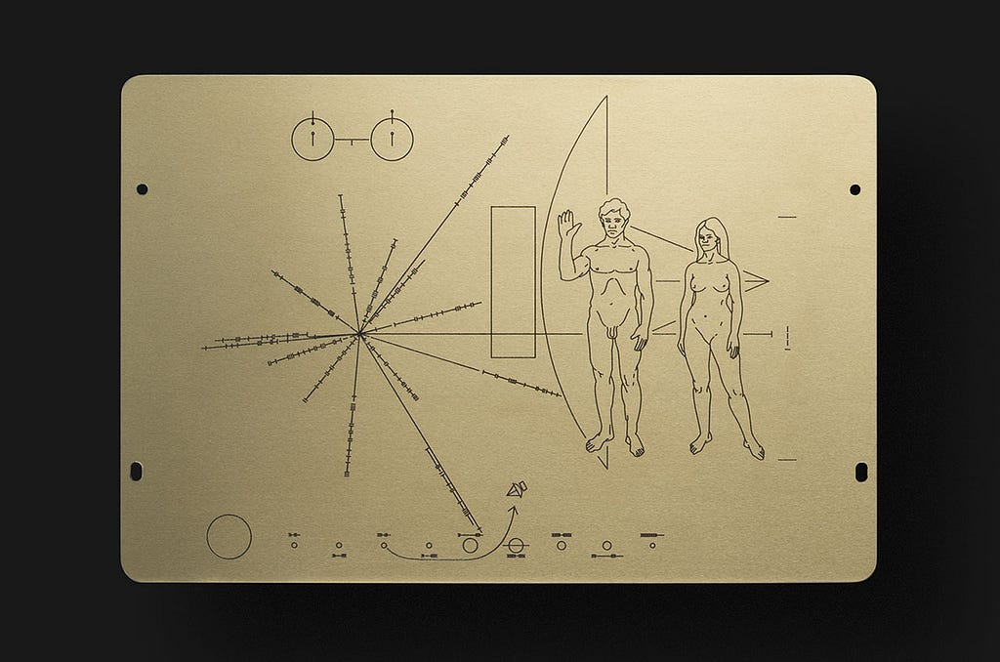

*The Pioneer plaque. Image courtesy of CollectSpace.*

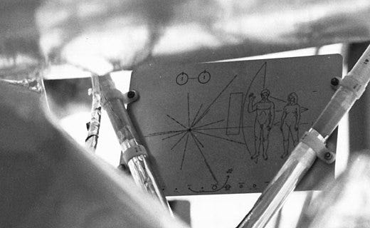

*Plaque attached to the Pioneer 10. Image courtesy of NASA.*

The original design was prepared in 3 weeks. Sagan and Drake designed the plaque, and Linda Salzman Sagan (Sagan’s wife) prepared the artwork. The plaque was manufactured by Precision Engravers in San Carlos, California, and was sent into space with the Pioneer 10 on March 2, 1972 and the Pioneer 11 on April 5, 1973.

I redesigned the plaque as the final project of VIS 217 (Graphic Design: Circulation) in Princeton's Visual Arts department. I created the design in Illustrator and then engraved it onto a 6-by-9-inch piece of acrylic using a laser cutter. I documented my process below because I thought it was a fun and cool design exercies. Props to David Reinfurt for creating the assignment!

## Design Assumptions

To constrain the design problem, I made a set of assumptions about the plaque's recipients. I tried keeping these assumptions as "realistic" [^realistic] as possible. Here's my list of assumptions:

- They perceive the world visually in a similar way as we do: they have vision that allows them to see the plaque and they are able to process graphical representations to make meaning out of them.
- They are scientifically equivalent or superior to us. They have as much scientific knowledge as we do (or more), and understand them and model them in a similar way as us (e.g., the atom is comprised of a nucleus and orbiting electrons, light can be modelled as both particles and waves, length contraction is a phenomenon in special relativity, etc.).
- They are able to observe the open sky and have knowledge of astronomy, including about galaxies, stars, planets, and comets.
- They use a numbering system, but not necessarily the ones we use.
- They use some unit of measurement to quantify time and distance, but not necessarily the ones we use.
- Recipients of the plaque will be somewhere within the Milky Way.

To make the last assumption, I started with some research into the Pioneer spacecrafts and found that their top speed is around 131,200 km/h. The closest galaxy to the Milky Way is the Canis Major Dwarf Galaxy, at 25,000 light years away (2.365 * 10^17 km). This means it takes approximately 204,547,000 years for the spacecraft to reach the galaxy at top speed. Even if there is some force that can accelerate the spacecraft to the speed of light, the spacecraft will take 50,000 years to make a round trip. If the recipients are outside the Milky Way, it's unclear that human civilization will even be around to receive a return message.

## An Alternate Way of Depicting Our Location

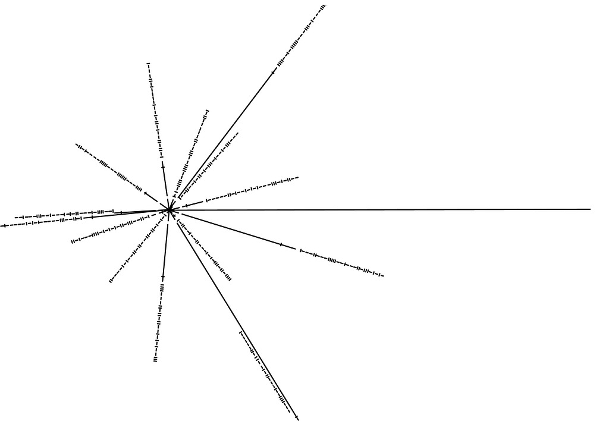

*The pulsar map on the original plaque*

One of the elements I found graphically confusing in the original plaque was the pulsar map. Although it’s an efficient way of organizing a large amount of information and a triangulates our location using common celestial phenomena, its form can be confusing. For example, the binary on “arms” of the pulsar map (that indicate the frequencies of the 14 pulsars of known directions from the sun) can be read in two directions — from outwards in and vice versa. Each direction yields different information. There are also 14 pulsars depicted, which means 14 numbers to read and interpret, and that can clutter the focus of the graphic.

Since I’ve assumed that the plaque will remain in the Milky Way, I decided to replace the pulsar map with a graphic of the Milky Way and the location of our sun within the galaxy. I’ve simplified the Milky Way so that only the major arms are depicted. I’ve also provided a “side profile” of the galaxy to show our location from two different perspectives for increased accuracy. The location indicator in the galaxy is a scaled down version of the sun and that serves as a graphic connection to the solar system graphic above it. While the Milky Way indicates our approximate location, the solar system graphic reveals the distances each planet from the sun and uniquely identifies our solar system.

Note: a few years after first publishing this blog post, one reader brought to my attention that [galaxy moves so we have to account for that].

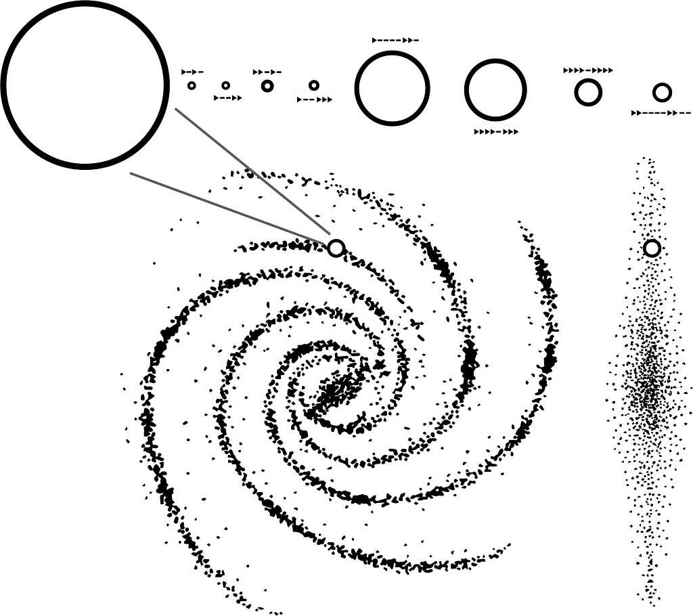

*The redesigned location indicator, featuring a simplified Milky Way*

## The Hydrogen Hyperfine Transition Graphic

The hydrogen transition diagram was something I aimed to overhaul in my redesign. The original graphic represented the spin-flip transition of hydrogen, the most abundant element in the universe. When a hydrogen electron changes its spin direction and jumps from one energy level to another, the radiation emitted has a wavelength of 21.106 cm and a period of 0.7 ns. A small vertical line is placed underneath as a binary 1 to specify a unit of length and time.

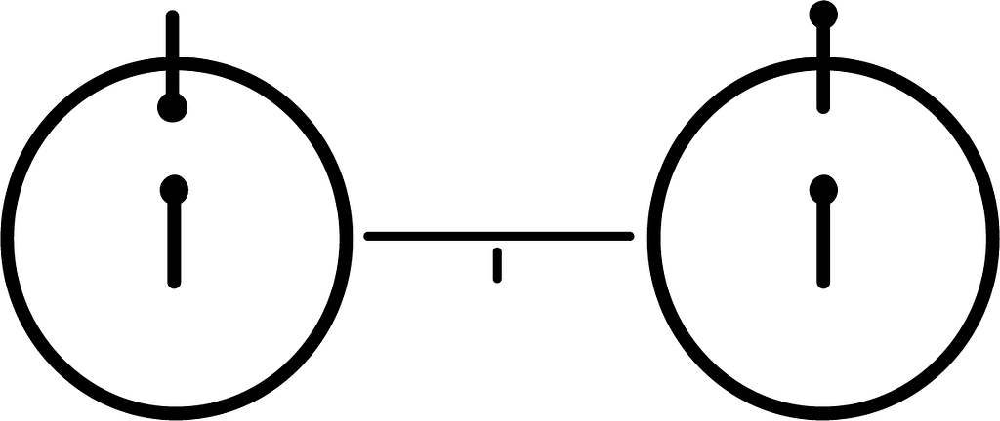

*Hydrogen hyperfine transition graphic on the original plaque*

I found it easy to confuse the hydrogen diagram with some sort of planetary formation connected by a line due to the size of the hydrogen diagram and the abundance of round forms. This is especially true given that the line weight and size of the hydrogen are both remarkably similar to those of the sun. The dots that represent difference in spin are also not the most effective in depicting objects in motion.

I first played around with redesigning the hydrogen graphic itself. For one of them, I took inspiration from the trailing tail of a comet to indicate movement, as it’s sight common across the universe. I received positive feedbak on it and used it to show movement in one of my other graphics as well.

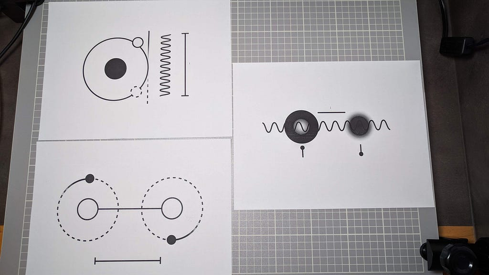

*My initial attempts of redesigning the hydrogen graphic*

I initially didn’t think any of the drafts as particularly effective, so I considered getting rid of the hydrogen altogether and use the speed of light to represent a unit instead, since it’s a universal constant. To do this, I based my design around the fact that the speed of light is equal to wavelength times frequency. I played around with graphical representations of frequency and wavelength of various waves. I also employed the Lorentz contraction, a concept in special relativity in which an object’s length in the direction of movement is measured to be shorter than its proper length when the object is moving at a substantial fraction of the speed of light. I placed 3 comet-like objects underneath the waves and showed their lengths contracting as they travel closer to the end of the wave.

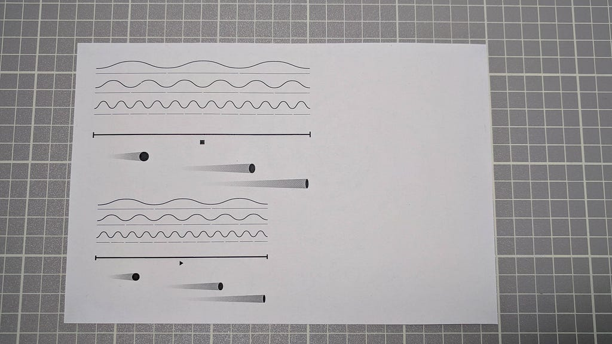

*Attempting to show the speed of light graphically*

Unfortunately, I realized a bit later that my whole idea was mathematically impossible without assuming some common measurement of distance and/or time. Since speed is comprised of two measurements (distance and time), establishing a common speed would only set a common ratio of distance and time, but is ineffective in offering any sort of direct translation between our units and foreign ones. It was like solving for two unknown values with only one constant.

I eventually realized the elegance of the idea behind the hydrogen graphic and returned to it, thinking about how to identify hydrogen without using mainly circular forms. I settled on using the emission spectrum lines of hydrogen as the unique identifier. To supplement that, I placed two small, simplified atoms of hydrogen showing opposing electron movement and a wave close to the atoms representing radiation from the hyperfine transition. Now that I have something quantifiable (wavelength), I set one wavelength as one unit. I then thought more carefully about the wave graphic and realized that I’ve been using waves under the assumption that I’m referring to light. All transverse waves can also be represented this way, including sound waves. Also, it's possible that the interstellar recipients have a different graphic to represent light waves. To clarify that the wave graphic is indeed referring to light, I added the Lorentz contraction graphic I devised earlier.

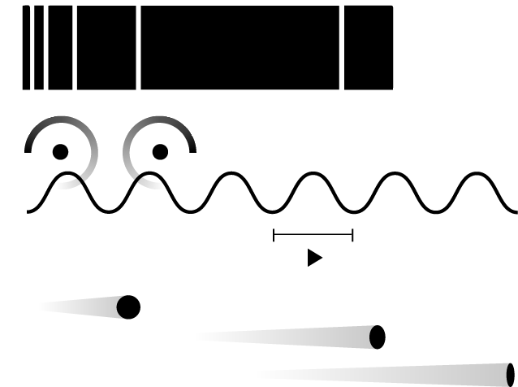

*Redesigned hydrogen hyperfine transition diagram*

## Establishing a Sense of Direction

One of the issues in the original plaque is that the tick marks representing binary can be read reasonably from left to right and right to left. Further, nothing from the original plaque indicates a "right side up." If the plaque was read upside down, the meaning can also get distorted.

In my redesign, I addressed this with two graphic elements: a “floor” for the plaque and a triangle as the “1” in binary. Presumably, the recipients of the plaque are residing on some massive body (planet or otherwise), which means that there is gravity and they understand gravitational force. I created a shaded “floor” to indicate the bottom edge of the plaque as well as to show how humans stand on ground. 

However, the binary can still be read from either horizontal direction, so I made the 1’s into triangles. With the triangle in place of vertical lines, reading from left to right is a different experience as reading from right to left. I also wanted to show that the further left one reads, the larger the values are, and the triangle, with its wider end to the left, is one way to show that. Now, the plaque has both a horizontal and vertical “correctness” and has a better chance of being read in the correct direction.

## Other Design Decisions

David Reinfurt had mentioned an interesting point about the arrow in the original plaque: the arrow graphic is an obvious sign of direction to us, but would it be as intuitive to the plaque’s recipients? As a result, I refrained from using any arrows in my redesign. To indicate that the spaceship came from Earth, I used a thin dashed line instead. I was hoping that a dashed line can represent a trail of some sort, and is thus a more universal way of representing a path.

I altered the relative size of the planets in the solar system slightly from the original. The planets in the redesign aren’t exactly to scale, but the slight scaling gives a good hint about their respective sizes and provides an additional aid to identifying our solar system. I removed the ring from Saturn as I didn’t think it was adding much (many other planets have rings anyway) and I’ve removed Pluto from the diagram (sad, I know, but it was too far out).

The graphic relationship between the “overhead view” and “side view” of the Milky Way was an interesting one to design. Originally, I used two identical bracketed lines to show that the distance between the center of the galaxy and the location indicator is the same, so the two diagrams must be referring to the same galaxy. I wasn’t super pleased with that: the lines were somewhat distracting and the two perspectives still seemed a bit disconnected. Based on feedback from peers, I got the idea of using two thin lines to connect the same elements in the two perspectives, which proved to be effective in communicating both galactic and distance equivalence between the two perspectives.

I preserved the human figures and spacecraft silhouette. It packages a lot of relevant information and also acts as a clever way to use the spacecraft to illustrate our size.

Below are some pictures showcasing the initial layout planning, to a first draft, to a refined draft, to finally a couple laser cut plaques.

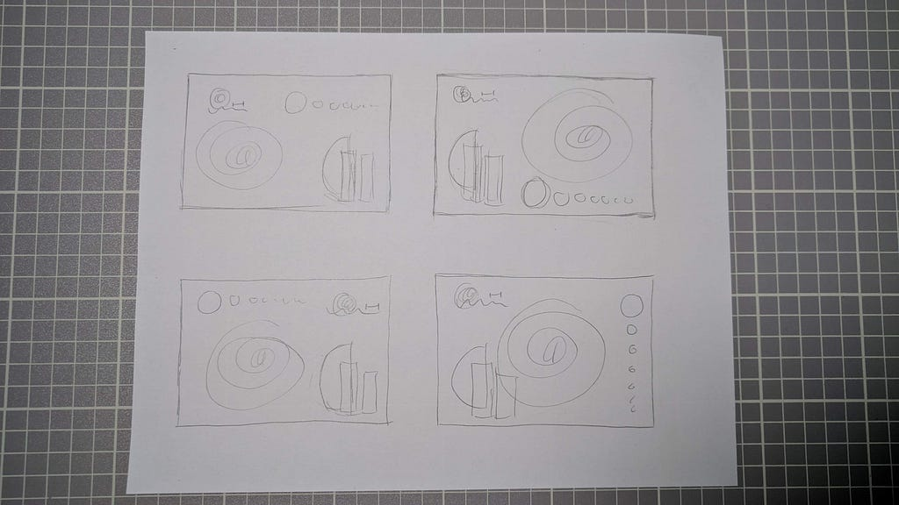

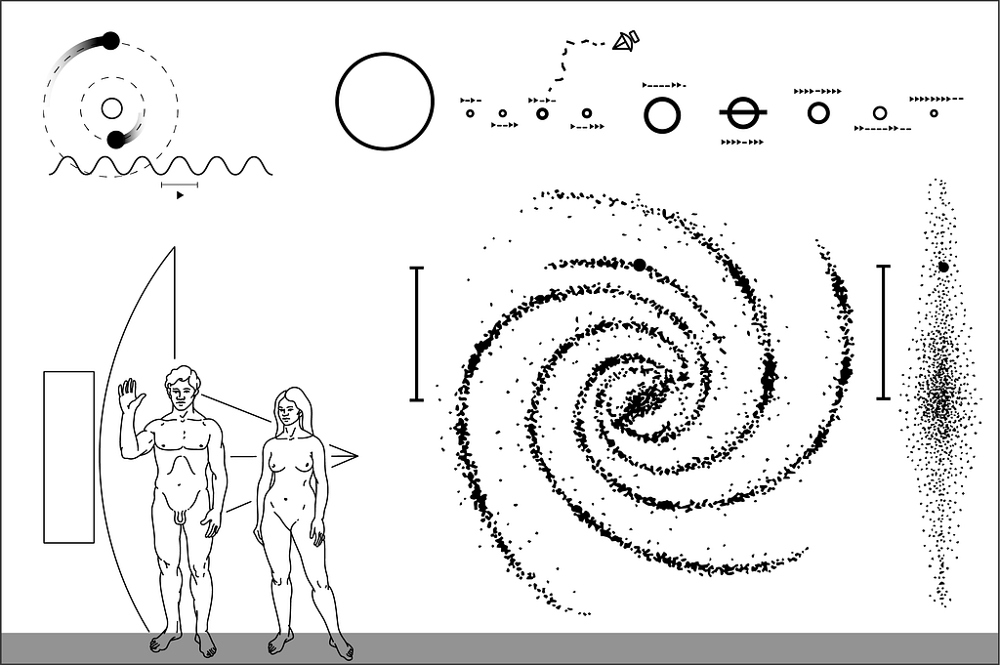

*The very first draft*

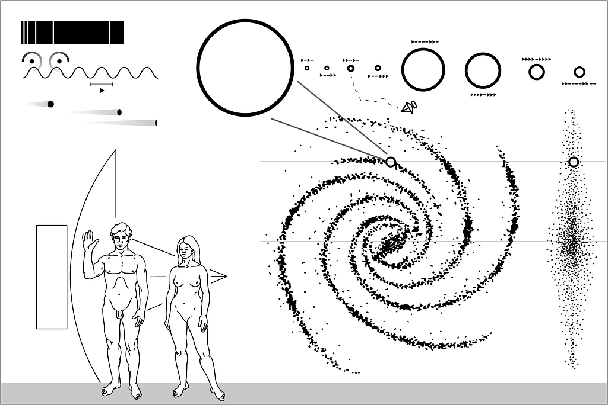

*A refined draft*

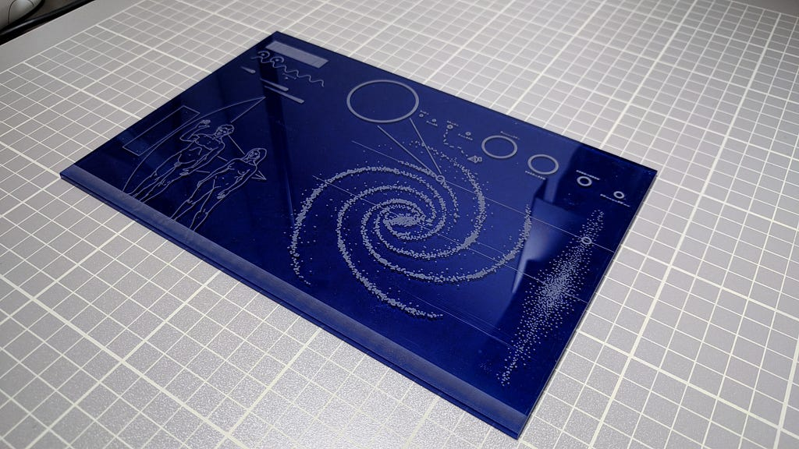

*A test cut using a thin, blue acrylic*

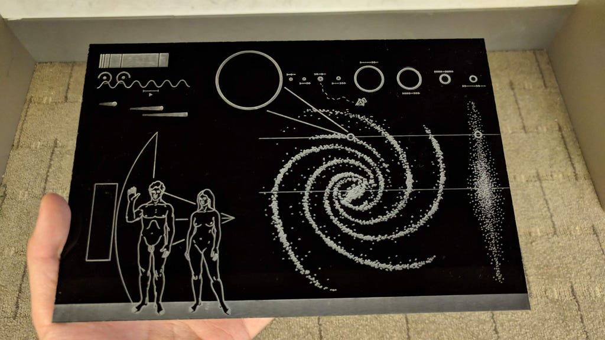

*The completed plaque*

## Conclusion

Once we take away our well-established intuitions when interpreting graphics, very interesting questions can arise. How do we represent time graphically? What about direction? How much meaning do we take for granted in the graphics we use every day? Overall, this was a great exercise in intentionally embedding meaning into graphical representations and efficiently organizing information. It was also fun thinking about physics (one of my favourite subjects in high school) and applying it to a design problem.

Going forward, one candidate for refinement is the current number system. In the original plaque, the hydrogen spin-flip transition graphic is helpful because the pulsar map uses the frequency directly. For me, the wavelength of the transition is just a way for me to represent one unit and establish a “1” in binary. The only other area I use binary is the solar system diagram, and those distances are not connected with the frequency or period of the spin-flip transition. It would be worth experimenting with once again removing the notion of hydrogen altogether and devising a new binary representation, possibly starting with a depiction of base 1 and then mapping it to base 2. The top left corner would then be specifically reserved for training the viewer to read new binary system.

Special thanks to David Reinfurt for creating this assignment, the StudioLab makerspace for the laser cutting equipment and materials, and for my peers in VIS 217 for valuable feedback.

[^realistic]: As realistic as one can get without knowing the ground truth behavior of an interstellar species. For example, assuming that species don’t use our Arabic number system is more "realistic" than assuming they do.