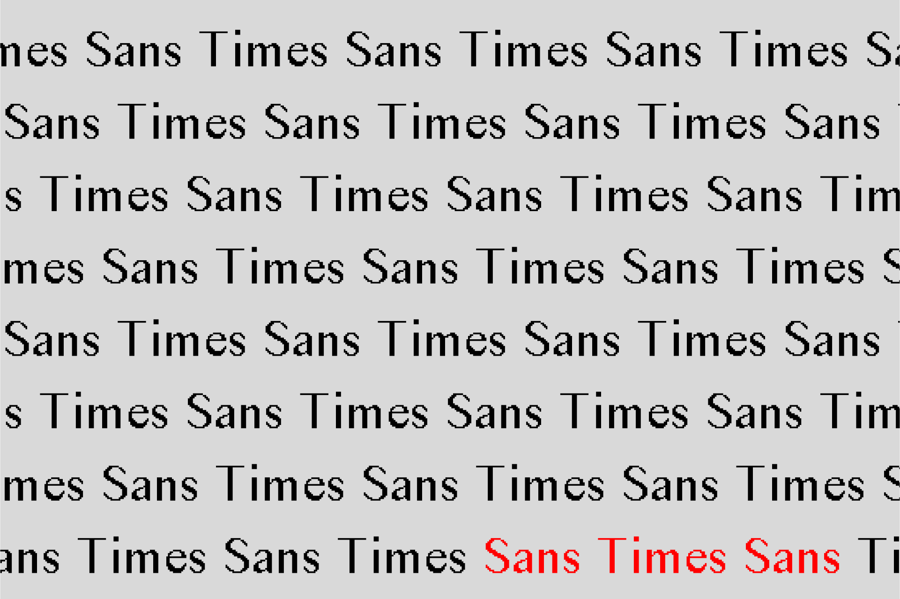
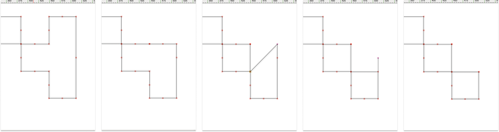
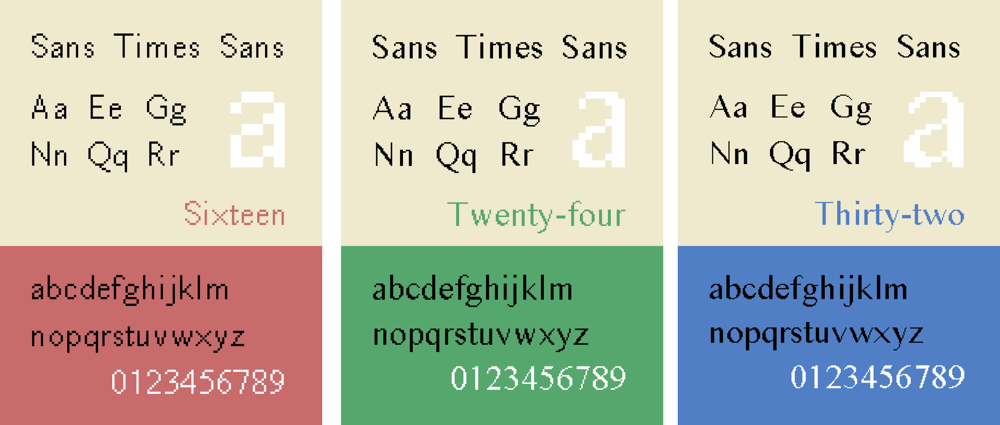
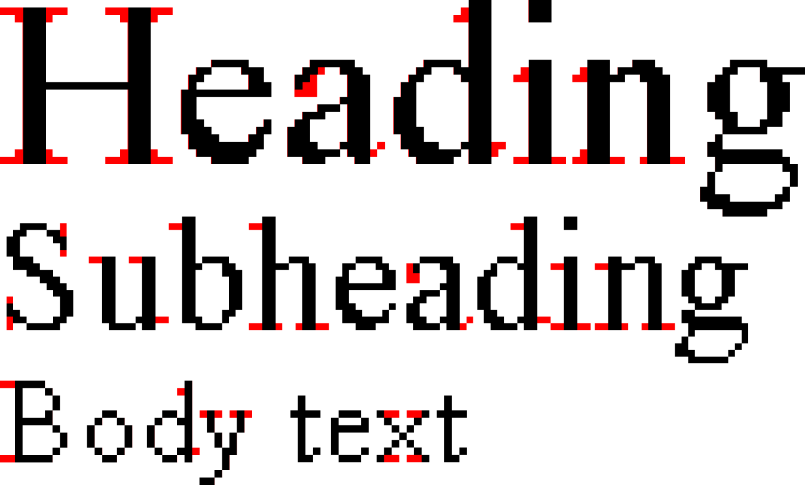
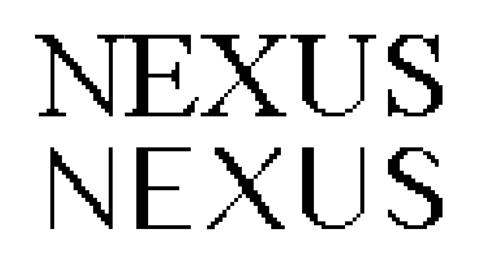
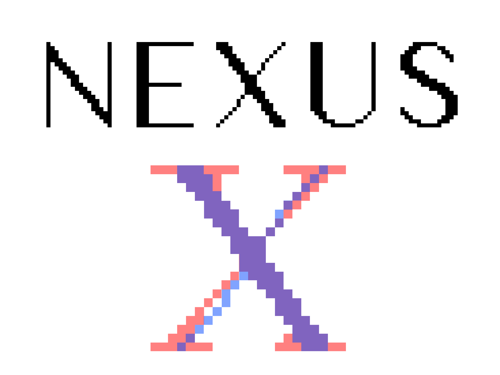

# Sans Times Sans
May 3, 2021

## Introduction

In his 1923 essay *The New Typography*, graphic designer and Bauhaus pioneer László Moholy-Nagy opened with the following:

> Typography is a tool of communication. It must be communication in its most intense form. The emphasis must be on absolute clarity since this distinguishes the character of our own writing from that of ancient pictographic forms. 

Moholy-Nagy was known for his pursuit of pure visual forms, as well being a restless experimentalist—something that served him well as a key figure in the maturation of the Bauhaus school throughout the 1920s. He advocated for the integration of contemporary methods and new technologies in art to realize the full potential of the artist. 

Would Moholy-Nagy would be dissapointed in the typographical scene of the modern web? During my time as a visual arts minor, I became interested in the design of [GeoCities](https://en.wikipedia.org/wiki/Yahoo!_GeoCities) websites. I was too young to have experienced the GeoCities era first-hand, but was nonetheless impressed by the experimentation, personalization, and expressiveness those websites reflected. It was as if everyone carefully tended to their own digital garden and offered friendly invitations to welcome in visitors at any moment. Compared to those websites, today's sites seem sterile and austere[^modern-web-austerity]. Moholy-Nagy wanted artists to answer humanity's needs through their art, and modern websites certainly have the potential to do so—their reach is broader and functionality richer than ever. However, rather than leveraging the latest technologies for radical refusal of the mundane a la Moholy-Nagy, we're experiencing an onslaught of overused web templates and cliché design patterns.

With this in mind, I wondered if there was a way to bring a touch of the GeoCities experimental spirit to the modern browser. I chose to do this through typography. One reason was that it was a common link between old and new websites: both thrived on Times New Roman (at least for a long while, until browsers started using the OS's system font family by default). Another was diffusion: unlike other graphical assets like banners or GIFs, which implement an aesthetic in a localized area, typography diffuses an aesthetic throughout a website. That way, the aesthetic can be ever-present yet subtle.

## A Starting Point

It's surpisingly challenging to replicate the appearance of a GeoCities-esque typeface on modern screens to match that of screens from the 90s due to [anti-aliasing](https://en.wikipedia.org/wiki/Anti-aliasing), a smoothing technique used by modern browsers. In short, anti-aliasing applies a slight blurring effect to the edges of the letterforms so it's harder to spot individual pixels around curvatures. Reverse engineering the anti-aliasing is not straightforward since there is no option to simply “turn off” anti-aliasing. Even if it was, the effect would visually be quite far off from the original due to today's screens being at a much higher resolution.

Fortunately for me, Caitlin White and Paul van der Walt from [Vistaserv.net](https://www.vistaserv.net) solved the exact anti-aliasing problem I was facing. I highly recommend reading their blog post, [Convincing-looking 90s fonts in modern browsers](https://www.vistaserv.net/blog/90s-fonts-modern-browsers) to learn about their process. Paul was generous enough to send me the font files for their anti-anti-aliased (aliased?) Times New Roman specimen, which came in 3 resolutions: 16px, 24px, and 32px for body, subheading, and heading text respectively. I preserved the same 3 resolutions for my design. You can read the blog post to find out more about what those resolutions mean, but here's a small tl;dr snippet from them:

> Fontforge [a font creation program] can convert fonts from vector to bitmap formats by creating bitmap strikes. Basically, a strike of a vector font, means its glyphs have been rasterised at a particular pixel size. Rasterisation at different sizes is important, because on an old-fashioned low-resolution screen, this is essentially what's happening: when rendering your text, the font is rasterised for your particular pixel density. For example, on a 75DPI screen, your 12 point font becomes 16 pixels high. These 16 pixels are big enough that you see them as jagged edges. However, if you're displaying 48 point text (a large heading, for example) on that same old-fashioned screen, you'll rasterise the font at 64 pixels, so already it'll seem much smoother.

At this point, I was given a strong foundation to experiment upon. I also took inspiration from typography work that explored modernity and its various implications through serif removal—most notably James Goggin's [Courier Sans](https://lineto.com/typefaces/courier-sans#about) and Eric Li's [Monti Sans](https://archive.eric.young.li/monti-sans/). It seemed fitting to attempt a similar exercise with this aliased Times New Roman. This was the basis of of Sans Times Sans, a sans-serif font based on Times (Times Sans) but simultaneously resists time (Sans Time).

## Point Folding

Goggin and Li took the approach of physically chopping off the serifs of printed versions of their original fonts. I worked only in Fontforge, without any other studio equipment (this was around peak COVID). The Fontforge UI unfortunately did not allow me to have the same satisfaction of physical serif-chopping. Instead, I removed the serifs by folding the control points of the vector lefferform into itself. The overlapping control points were then merged. Overall, the process was one of slow and deliberate reduction, not so much one of immediate erasure.

*Point folding of the top right serif of a capital S (16px variant) in Fontforge.*

*Capital S's (16px variant): Sans Times Sans (left), aliased Times New Roman (center), and diff in red (right).*

Point folding was a very manual process, but I could not think of an effective way to automate it. Although it was manual, it not all of it was mechanical—some folding required judgement calls on what looks better and/or what aligns more closely with the “core” of the original serifed letterforms. I ended up manually point folding all the commonly used letterforms over the course of 1–2 months to create the font family. Below are some examples of Sans Times Sans in all 3 variants and comparisons with its serifed counterpart.

*Specimens of 16px (left), 24px (center), and 32px (right) variants.*

*Diffs in red of the 3 variants with aliased Times New Roman.*

## Challenges

As mentioned before, additional judgement is sometimes necessary to ensure that the removal of a serif does not result in a distorted letterform. This judgement was especially useful with the capital X in the 32px variant. Simply removing the serif resulted in a letterform that was uneven in stroke and carried a slight italic slant.

To fix this, I had to make some heavier changes to the rest of the letterform, thickening one arm of the X while making the other thinner and more symmetrical. I also removed the slight italicization on the original letter, which involved adjusting a large number of control points outside of point folding. The result didn't eliminate all awkwardness, but it looked more cohesive and sans-serif than before.

*Unlike most other letterforms, the 32px capital X underwent a slight italics correction. It is shown above in translucent blue while its serifed counterpart is in translucent red.*

A side note: although the 16px capital X also looks quirky, its individuality makes it one of my favourite letterforms in the family.

## In Use

I used Sans Times Sans as the primary font in I-n-t-e-r, my senior thesis exhibition. To see it in action, view the photos from the show [here](https://i-n-t-e-r.github.io/show), or the general show site [here](https://i-n-t-e-r.github.io). Overall, working on this font encouraged me to think about how to embed principles and intentions into the design of letterforms, rather than treating type design as a purely aesthetic exercise.

Special thanks Caitlin White, Paul van der Walt, and the rest of Vistaserv for making this project possible. Also thanks to David Reinfurt and Victor Guan for insightful discussions and generous feedback throughout the entire process.

## Download (.ttf)

- [Sans Times Sans @16R (body)](../fonts/SansTimesSans@16R.ttf)
- [Sans Times Sans @24R (subheadings)](../fonts/SansTimesSans@24R.ttf)
- [Sans Times Sans @32R (headings)](../fonts/SansTimesSans@32R.ttf)

[^modern-web-austerity]: A note from the future (2026): this is more true than ever thanks to the prevalence of vibe-coded websites.
